# RepoRead architecture

How RepoRead is built today: the parts, who owns what, and how data moves between them. The *why* behind each decision is in the [ADRs](adrs.md); the exact HTTP contract, limits and error codes are in the [backend README](../backend/README.md); phone behaviour is in the [Android README](../android/README.md). The rules every change keeps are in [invariants](invariants.md). This document links to them instead of repeating them.

As built on `main` at `b148d9d`, 2026-10-22. This describes source behavior, not the hosted or installed revision.

## 1. The system in one picture

RepoRead is a reading and study layer over Markdown notes in GitHub. Three things hold state, and each owns a different part of it:

| Owner | Holds | Never holds |
| --- | --- | --- |
| **GitHub** | The notes themselves (canonical, read-only to RepoRead) | Anything of RepoRead's |
| **Backend** (Spring Boot + PostgreSQL) | Users, sessions, each user's GitHub tokens (encrypted), repository connections, document identity and versions, reading state, bookmarks, highlights, cards, the review log; every reconciliation decision | Note bodies (fetched by blob SHA on demand, never cached) |
| **Phone** (Android + Room) | A projection of the server's lists, saved rendered copies of opened notes, pending local changes, the review schedule | GitHub credentials |

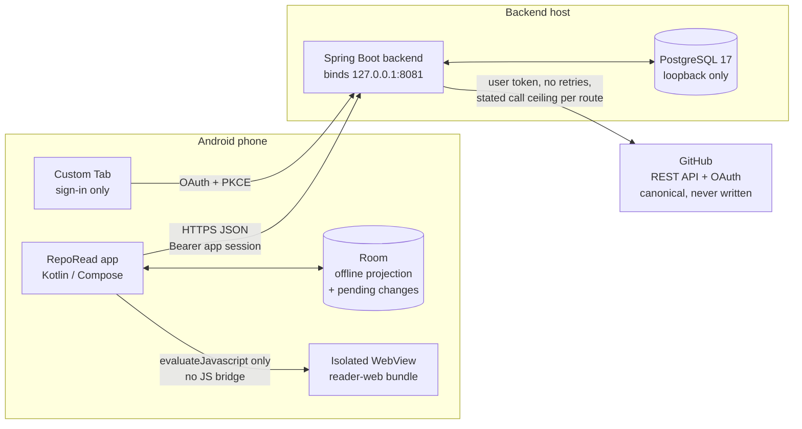

Two rules shape everything below:

- **GitHub is the source of truth and is never written to** ([ADR-02](adrs.md#adr-02--github-is-canonical-and-read-only-note-bodies-are-not-stored-on-the-server)). A note's content is always addressed by its blob SHA.
- **The server renders, the phone displays** ([ADR-04](adrs.md#adr-04--the-server-renders-an-isolated-webview-displays)). One Java renderer defines the HTML and each block's canonical text, so a selection on the phone means the same thing on the server.

## 2. Deployment and delivery

Release builds talk to a hosted backend; debug builds talk to the developer's Mac. Both run the same jar.

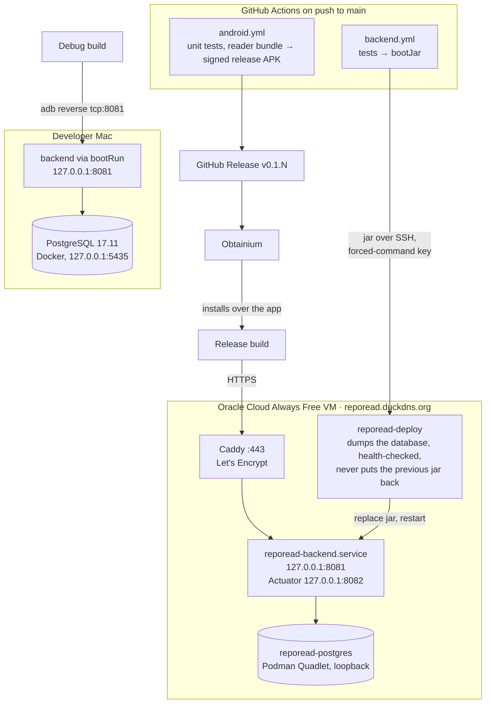

- Only 22, 80 and 443 are open on the VM; PostgreSQL, the API port and Actuator listen on loopback ([ADR-14](adrs.md#adr-14--hosted-backend-on-an-oracle-cloud-always-free-vm-debug-builds-stay-on-the-mac)).
- Every build is signed with one personal key, so each release installs over the last and keeps the phone's data; the debug build is a separate app beside it, with its own data and sign-in redirect ([ADR-12](adrs.md#adr-12--personal-distribution-one-signing-key-backend-over-adb-reverse), [ADR-15](adrs.md#adr-15--app-releases-through-github-releases-installed-by-obtainium)).
- Restarts and deploys keep GitHub sign-ins: tokens are stored encrypted in PostgreSQL under a key file kept on the host, outside the database ([ADR-03](adrs.md#adr-03--github-user-tokens-stay-on-the-server-encrypted-at-rest)).

## 3. Backend

One Spring Boot 4 / Java 25 service, a modular monolith with one package per concern (`backend/src/main/java/com/reporead/`). Data access is plain Spring JDBC; the schema is owned by Flyway migrations (`backend/src/main/resources/db/migration`).

### Packages and their dependencies

Arrows point from a package to the packages it calls (from the imports in each file). The packages form a stack with no cycles: each calls only packages below it, and `deletion`, which deletes across every owner, and `library`, which reads the phone's lists across their owners in one snapshot, are on top. Every package with routes also reads the signed-in user (`auth.AppUser`); those arrows are left out. The stack is of imports: SQL reads do cross owners (`Documents` checks reading and annotation rows, `RepositoryConnections` counts documents), which ADR-01 allows, since each table's writes stay with its one owner. Controllers call owners only; no controller calls GitHub.

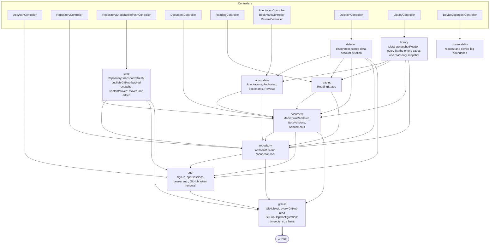

| Package | Owns | Key classes |
| --- | --- | --- |
| `auth` | GitHub OAuth (Spring Security), single-use sign-in codes bound to a PKCE challenge, 30-day bearer sessions (only hashes stored), the encrypted stored GitHub token (`GitHubTokens`) and its renewal and revocation (`GitHubTokenLifecycle`) | `ApiSecurity` (loopback only, the API and management chains), `GitHubBrowserSignIn` (browser sign-in), `GitHubTokens`, `GitHubTokenLifecycle`, `AppSignInSuccess`, `AppSessions`, `BearerAuthentication` |
| `github` | Every GitHub REST read, with the user's token; the HTTP clients every GitHub call goes through: 15 s timeouts, no redirects, no retries, response size limits (the largest note RepoRead reads), and the count of every GitHub request | `GitHubApi`, `GitHubHttpConfiguration` |
| `repository` | Which repositories a user may connect (GitHub decides, through the user's token) and has connected; the connection row lock every write shares | `RepositoryConnections` |
| `sync` | Refreshing and publishing a complete default-branch snapshot; document identity across moves ([ADR-07](adrs.md#adr-07--document-identity-from-complete-snapshots)) | `RepositorySnapshotRefresh`, `ContentMoves` |
| `document` | Rendering and sanitizing Markdown into reader HTML with canonical block text; fetching a version by blob SHA; images and Obsidian embeds | `MarkdownRenderer`, `NoteVersions`, `Attachments` |
| `reading` | Last-read version, position and progress per note; last write wins by the client's time | `ReadingStates` |
| `annotation` | Highlights, cards and bookmarks; idempotent creation by mutation id; re-anchoring ([ADR-06](adrs.md#adr-06--re-anchor-only-on-measured-evidence-otherwise-orphan)); the immutable review log | `Annotations`, `AnnotationService` (creation, reattachment and re-anchoring against note versions), `Anchoring`, `Bookmarks`, `Reviews` |
| `deletion` | Disconnecting a repository and deleting the account: what it would delete, and deleting it through each table's owner in one transaction ([ADR-11](adrs.md#adr-11--disconnecting-deletes-everything-stored-for-that-repository-account-deletion-deletes-everything)) | `ConnectionDeletion`, `AccountDeletion`, `DeletionController` |
| `library` | The phone's one read of the server's lists: repositories with every document, reading states, bookmarks and the notebook, each from its owner, in one read-only `REPEATABLE READ` transaction of a fixed 6 queries, refused over 8 MiB ([ADR-08](adrs.md#adr-08--offline-a-room-projection-plus-explicit-pending-changes)) | `LibrarySnapshotReader`, `LibrarySnapshot`, `LibraryController` |
| `observability` | The request id and outcome boundary; journald priority conversion; authenticated ingestion of typed device-log batches into the server journal, with no stored copy | `RequestLoggingFilter`, `JournaldPriorityConverter`, `DeviceLogIngestController`, `DeviceLogLine` |
| root | Error responses (`{code, message}`), shared PostgreSQL text-storability and hash rules | `ApiErrors`, `ApiFailure`, `StoredText`, `Hashes` |

### Data model (PostgreSQL)

Highlights and cards share the `annotations` table, told apart by `type`; a bookmark is a row of `bookmarks` (ADR-17). Until ADR-17's contract step, the `annotations` type check still admits the `BOOKMARK` rows V17 moved out. A highlight or card has an original anchor that never changes and a current location that re-anchoring moves. Every column of every table is listed, in the database's order, as the Flyway migrations leave it.

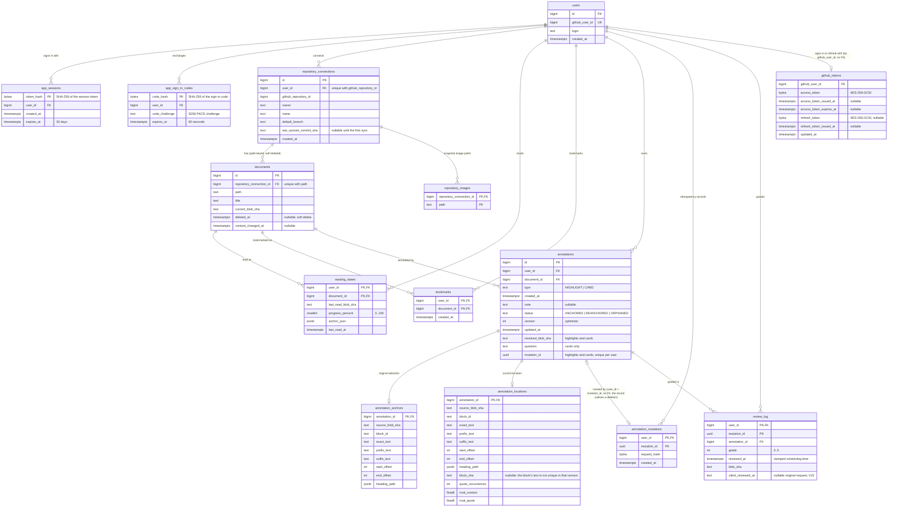

Concurrency: new highlight/card admission first serializes on the user row (`FOR NO KEY UPDATE`), then shares the connection lock, so the per-document and user-wide caps cannot be exceeded by concurrent creations across repositories. Exact replays bypass capacity; no GitHub I/O runs under these locks. Other document writes do not acquire this admission lock. Syncs, reconnects (whose upsert locks the row), disconnects and every write that adds or changes a document's rows take the same `repository_connections` row lock (`RepositoryConnections.lockForSync` and its siblings), so a write never lands half-way through a sync or a disconnect. Each table's owner takes the lock inside its own transaction, and the lock methods refuse to run outside one.

## 4. Android app

One Activity (`MainActivity`) hosting Compose (`RepoReadApp`), whose back stack Navigation 3 owns: `Entry(id, screen)` keys saved with the activity and across process death, each entry keeping saved UI state and a ViewModel store while in the stack. Activity state restores only when its saved format marker is compatible, independently of build number (ADR-27). Each screen that starts work has one ViewModel in its entry, which owns its loads, operations and outcomes; screens draw its state and call its actions (ADR-28). No DI framework; background work runs only in WorkManager: the background sync of local changes (ADR-08) and Save all (ADR-19).

### Screens and layers

Submitted edit/conflict state belongs to the reader's ViewModel, restoring only the submitted id/text and reloading
the annotation. In-progress reattachment also restores through its SavedStateHandle. Unsubmitted overlays remain
UI-owned; rejection cannot close their editor (ADR-28).

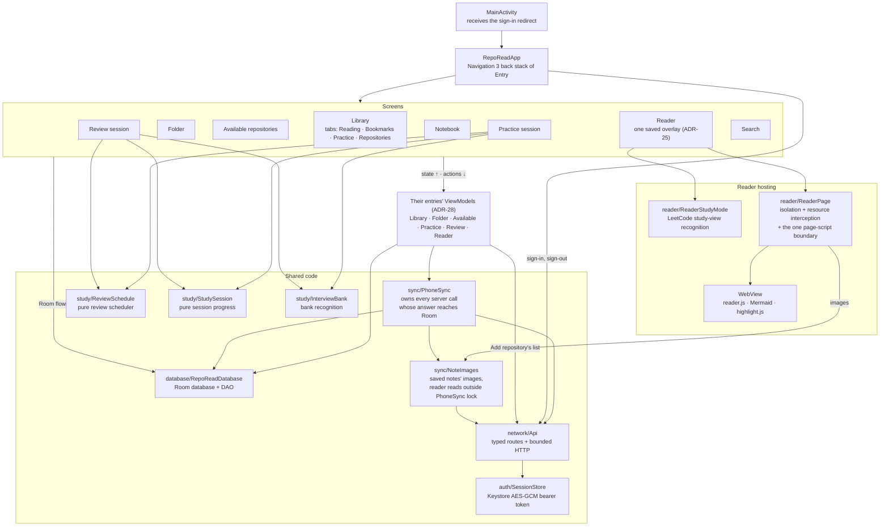

| Package | Owns |
| --- | --- |
| (root) | `RepoReadApplication`: long-lived objects, including one `PhoneSync` per process and its startup image sweep; `Account`: sign-in, sign-out and account deletion, one at a time in the app's scope, and their outcomes (ADR-22); `RepoReadApp`: Navigation 3 back stack/entry owners (ADR-27), retained across account operations; `MainActivity`: sign-in redirect and compatible saved-state restoration |
| `auth` | PKCE sign-in through a Custom Tab and validated code exchange; `SessionStore`: encrypted bearer session and pending verifier, no local-data owner or removal state |
| `network` | `Api`: the only executor of backend paths, with one named function per app-used route, exact success statuses, bounded responses and request/response correspondence; `wire/`: the wire models, generated at build time from `backend/openapi.json` (never committed or edited); `WireRules.kt`: the value rules a generated shape cannot state; `WireJson.kt`: one decoding policy, strict scalar/time serializers and `INVALID_RESPONSE` with its cause. Unknown fields are compatible, missing required-nullable keys are not. `ApiException(status, code)` carries a strictly decoded server error or a local HTTP/I/O failure; any 401 ends the stored session (`SessionStore.endRefused`), which signs the app out wherever the call was made; a stored session it cannot read now fails the request unsent (`SESSION_UNREADABLE`) |
| `logging` | `DeviceLog`: logcat plus the bounded durable device-log store, whose `pending.jsonl` and `sending.jsonl` filenames and JSON fields remain stable across app updates. `DeviceLogUploadWorker` (in `sync/`, with the other WorkManager jobs) makes at most two upload requests per run (a failed run's batch, then the lines since) and never retries on a backoff; a warning requests a run only when no batch is claimed |
| `database` | `RepoReadDatabase`: the Room database and its migrations; `Entities.kt`: its tables; `QueryResults.kt`: its query projections and database-local results; `RepoReadDao.kt`: its queries and cross-entity transactions (schema history in `android/schemas/`) |
| `sync` | `PhoneSync`: the process's one local copy, refreshes, opening notes, pending/local changes, annotation/card mutations, disconnect and image sweeps. Its lock orders local mutations and server answers; `committed` protects accepted screen mutations through local commit (ADR-28). `NoteImages` retains its file lock and deletion generation, preventing a late image fetch from republishing files after a sweep. An open sweeps after its fetched page; Save all sweeps once after a successful loop under cancellable `locked`, rather than after every fetched page. Failure/cancellation defer cleanup to the next library refresh, Library open or startup. Library replacement, disconnect and startup retain their sweeps. Save all checks one page at a time, including already-current copies, and prefetches its distinct images under the existing per-page PhoneSync lock before progress; WebView image reads remain outside that lock (ADR-19). Only the reader's `NoteImages.image()` catches API failures as unavailable; Save all uses the throwing fetch, `PhoneSync` owns permanent page skips, and the existing worker owns retry/stop for all other API failures. `WireMappings.kt` maps validated wire records; `PhoneSync` owns disposition: `refusesItem()` classifies annotation, review and bookmark refusals; the reading send handles only 404 `NOT_FOUND` inline and raises every other failure, including a malformed-save 400. `PendingSyncWorker.kt`, `DeviceLogUploadWorker.kt` and `SaveAllNotesWorker.kt` own their independently scheduled WorkManager jobs; `WorkerRetry.kt` owns their shared fixed retry ceiling and backoff. Pending sync and Save all enter `PhoneSync` directly, without waiting for account operations; repository Stop awaits cancellation. Account operations never clear Room/images or cancel/prune work. Account calls Api for sign-in, sign-out and deletion; Add repository lists through Api and connects through PhoneSync |
| `library` | Library tabs, Notebook (`Notebook.kt`), the folder screen and folder filters (`Folder.kt`), and Add repository (`Available.kt`); each work-owning screen's ViewModel is in its file (ADR-28) |
| `study` | Practice (`Practice.kt`) and Review's screen/session owner (`Review.kt`) with their entry ViewModels; `ReviewAnswer.kt` owns answer loading/rendering, and `ReviewOutlook.kt` owns the midnight/time-zone-aware outlook used by Library, Practice and Review completion; the pure review scheduler (`ReviewSchedule.kt`), session progression and note interleaving (`StudySession.kt`), bank recognition (`InterviewBank.kt`) and bank answer views (`Answer.kt`) |
| `reader` | The reader state/effect owner and ViewModel (`Reader.kt`, including visible bookmark rejection for a disconnected note); its toolbar/system bars (`ReaderToolbar.kt`), note and notes-panel rendering (`ReaderContent.kt`), and saved overlays (`ReaderOverlayHost.kt`); page hosting and isolation with one JSON decode boundary in `ReaderPage.evaluate`; outline, notes, backlinks, link resolution and previews; and LeetCode study-view recognition (`ReaderStudyMode.kt`) |
| `ui` | Shared Compose components, including the screen load state and its retry presentation (`Load.kt`) |
| `search` | Local substring search over saved titles, canonical note blocks and highlights; body results carry their exact Reader block ([ADR-10](adrs.md#adr-10--search-is-local-substring-matching-over-what-the-phone-has-saved)) |
| `reader-web/` | The page's display JavaScript and CSS, bundled by esbuild into the APK; parses no Markdown and makes no network requests |

`study` uses `reader`'s link parsing and resolution; `reader` does not import `study`.

### Room: a projection plus pending changes

Room never decides anything the server owns; it mirrors complete server responses and queues the user's own changes until acknowledged ([ADR-08](adrs.md#adr-08--offline-a-room-projection-plus-explicit-pending-changes)).

| Table | Comes from | Pending local changes? |
| --- | --- | --- |
| `repositories`, `documents` | Server's complete lists (replaced, never merged), with every other list from one library answer in one transaction | No |
| `notes` | Latest rendered copy of each opened note, one per document with its blob SHA | No |
| `note_search_blocks` | Server-issued canonical block IDs/text for each saved page, written and deleted with it | No |
| `note_links` | The note links of each saved page, written and deleted with it, for **Linked from** | No |
| `reading_states`, `bookmarks` | Server lists, merged with local saves | Yes, last write wins by time |
| `annotations` | Notebook and per-note listings | Yes: creations (with mutation id) and deletions of unacknowledged creations |
| `review_log` | Server's durable log | Yes: grades (with mutation id) |

The columns, as the latest exported schema (`android/schemas/`) lists them, in its order. Only `note_search_blocks` and `note_links` have foreign keys, to `notes` with delete cascade; every other reference is by id and not enforced by the database. Booleans are stored as 0/1 integers, and an embedded passage is stored as columns prefixed with its field name (`location…`).

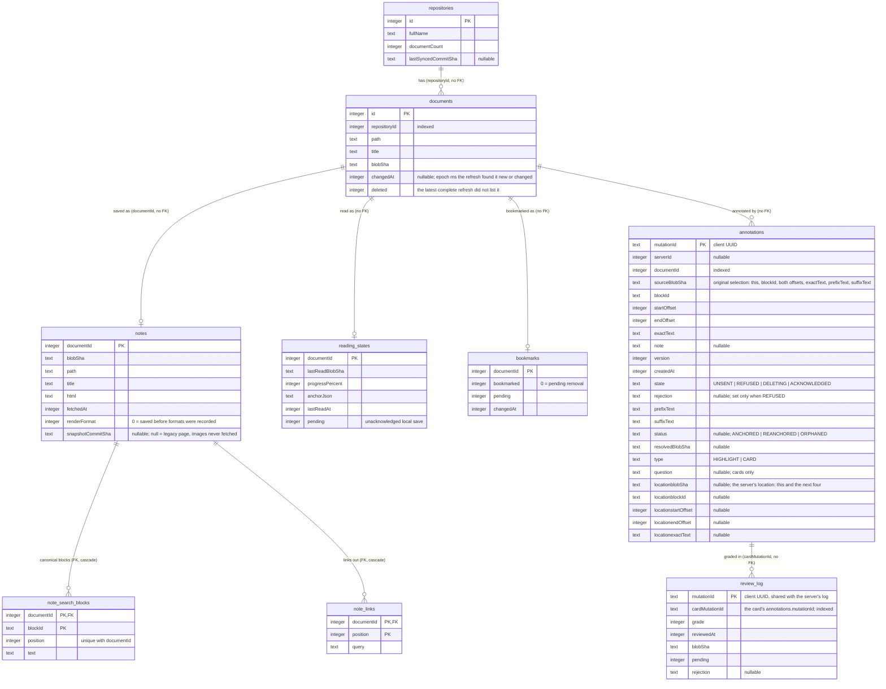

## 5. Key flows

### Sign-in

The phone never sees a GitHub credential. It gets an opaque app session in exchange for a one-time code bound to its own PKCE challenge.

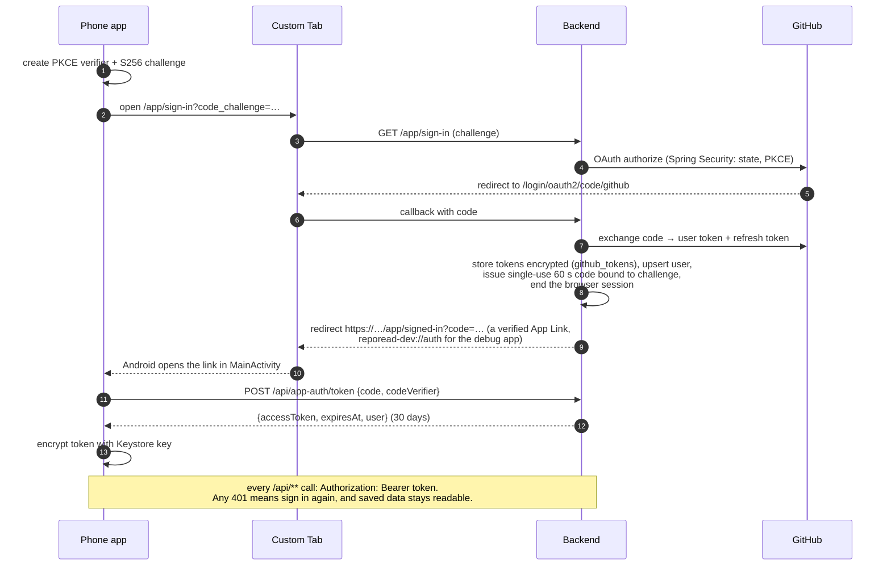

### Refreshing a repository (sync)

A repository snapshot refresh publishes the default branch's complete snapshot or changes nothing ([ADR-07](adrs.md#adr-07--document-identity-from-complete-snapshots)).

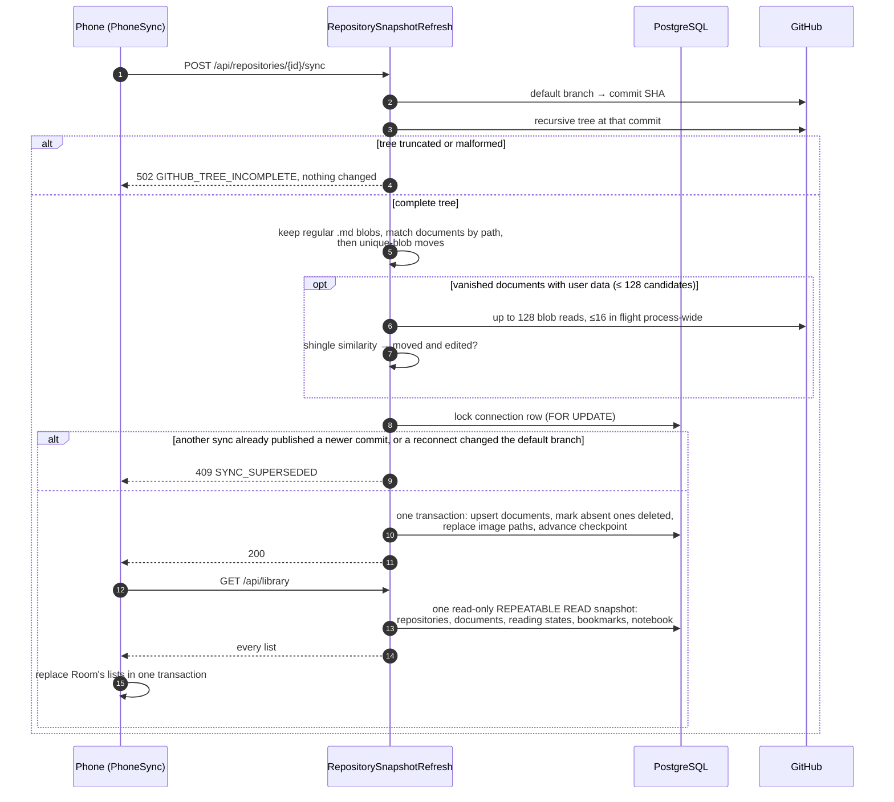

### Opening and displaying a note

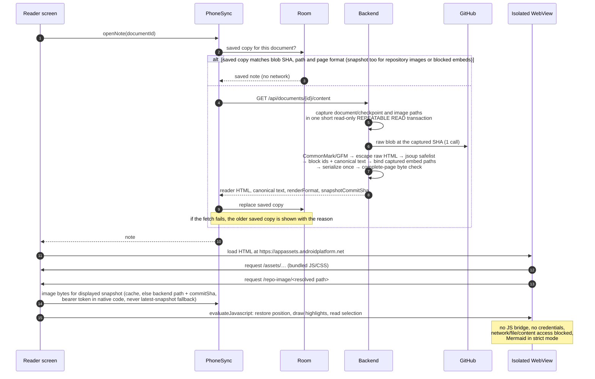

Links the page needs native help with (`/note-link`, `/copy-code`) are same-origin URLs the app intercepts; the page itself can't call native code.

### Phone pending changes and repository snapshot refresh

Local changes are written to Room first. Each asks WorkManager for a background pending-change send once the phone has a network (5 s after the last change, retried by WorkManager for an unreachable server, 5xx, or GitHub unavailable, at most 10 attempts). Opening the Library, pull to refresh, or **Send changes** sends pending mutations and then loads the server's library in one request; the background sender leaves lists alone. Opening a note also sends waiting highlight and card creations. All local mutations and server answers use the process's one `PhoneSync` lock. Separately, **Check GitHub for updates** calls `RepositorySnapshotRefresh` through the stable `POST /api/repositories/{id}/sync` route; it reads GitHub's default-branch tree, publishes a complete server snapshot, then reloads the phone's library. Sign-out and confirmed account deletion clear the session, never Room or image files. Account operations retain entries and do not gate background work. A different account replaces acknowledged lists at its first library load; unsent work can be sent under that account (the accepted one-account limit, ADR-22). Mutation ids make resending safe.

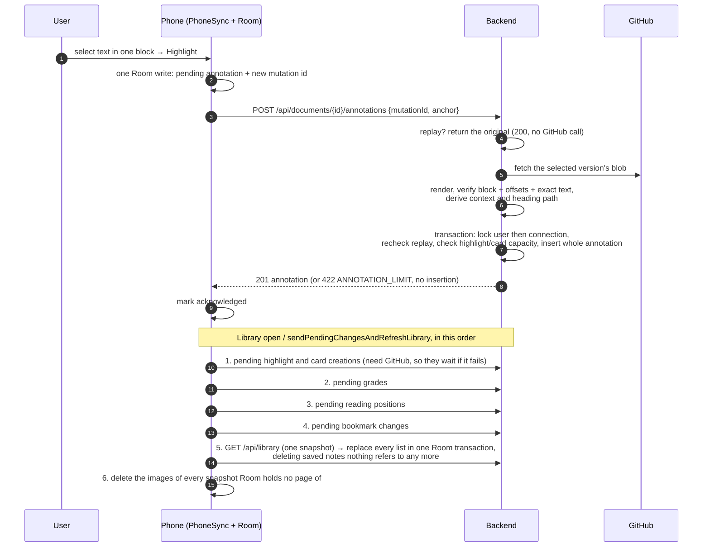

Only the known status/code pairs in `PhoneSync.refusesItem()` permanently refuse an annotation, grade or bookmark; a status family alone is not authority. Reading saves separately accept only 404 `NOT_FOUND` as final. In particular, 422 `ANNOTATION_LIMIT` and 409 `REPOSITORY_RENAMED` leave creations pending, because capacity or repository identity can change without changing the mutation. Any other failure leaves the item pending: sending a highlight or card stops the remaining creations but not the database-only work (ADR-03) unless the server is unreachable, and sending a grade, reading position or bookmark ends the run.

### Re-anchoring

When a note changes, each highlight or card is resolved against the new version the next time the note's annotations are listed, not at refresh ([ADR-06](adrs.md#adr-06--re-anchor-only-on-measured-evidence-otherwise-orphan) says why). The original anchor never changes ([ADR-05](adrs.md#adr-05--anchors-are-block-ids-and-utf-16-offsets-into-canonical-text-of-one-version), [ADR-06](adrs.md#adr-06--re-anchor-only-on-measured-evidence-otherwise-orphan)).

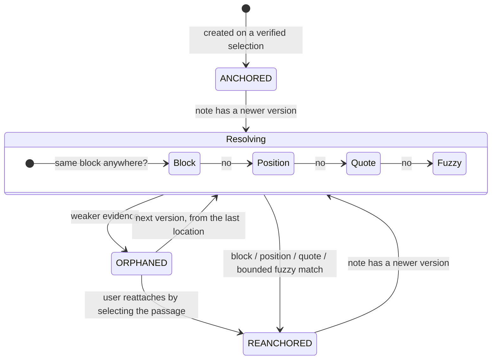

### Practice and review

Cards are anchored annotations with a question: interview-bank questions, anchored to their Canonical line. The server owns the immutable review log; the phone owns scheduling and the session size (40) ([ADR-13](adrs.md#adr-13--anchored-cards-server-review-log-phone-only-scheduling)).

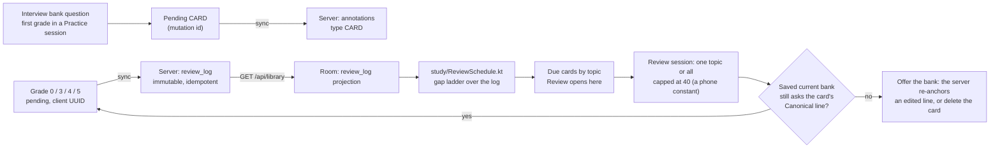

Practice questions are recognized on the phone from saved copies of notes under an `interview/` folder (`study/InterviewBank.kt`); a Practice session makes no network calls.

## 6. Trust boundaries

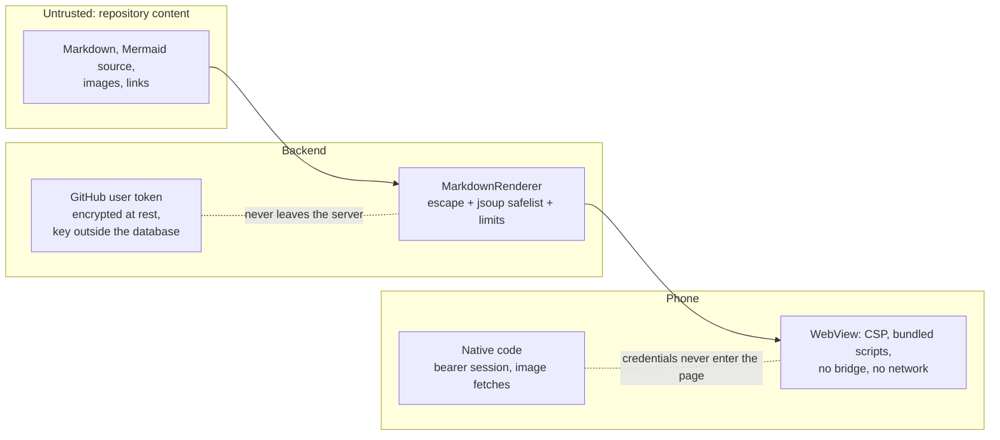

- The GitHub token stays on the server; the phone holds only a revocable app session ([ADR-03](adrs.md#adr-03--github-user-tokens-stay-on-the-server-encrypted-at-rest)).
- Rendered content can't run code: raw HTML is escaped, output is sanitized, and the WebView only loads bundled assets and the note's own images through native code.
- Every route is scoped to the signed-in user; another user's ids return 404 without a GitHub call.
- The release signing key is also a GitHub Actions secret, so the GitHub account is part of the app's trust boundary ([ADR-15](adrs.md#adr-15--app-releases-through-github-releases-installed-by-obtainium)).

## 7. Where the details live

| Topic | Source |
| --- | --- |
| Why each decision was made, and what it costs | [adrs.md](adrs.md) |
| Rules every change keeps | [invariants.md](invariants.md) |
| Scope, stage gates, post-MVP status, known gaps, what is unverified | [feature-list.md](feature-list.md) |
| User needs and acceptance criteria | [user-stories.md](user-stories.md) |
| Every route, its GitHub call ceiling, error codes, server-owned limits, metrics | [backend/README.md](../backend/README.md) |
| Hosted VM layout and deploys | [backend/README.md § Hosted VM](../backend/README.md#hosted-vm) |
| Phone behaviour, offline rules, signing, device tests, Room schema versions | [android/README.md](../android/README.md) |
| Reader display bundle and its device check | [android/reader-web/README.md](../android/reader-web/README.md) |
