# RepoRead architecture

How RepoRead is built today: the parts, who owns what, and how data moves between them. The *why* behind each decision is in the [ADRs](adrs.md); the exact HTTP contract, limits and error codes are in the [backend README](../backend/README.md); phone behaviour is in the [Android README](../android/README.md). The rules every change keeps are in [invariants](invariants.md). This document links to them instead of repeating them.

As of 2026-10-14, including Practice sessions and Review in the Practice tab (branch `review-in-practice`).

## 1. The system in one picture

RepoRead is a reading and study layer over Markdown notes in GitHub. Three things hold state, and each owns a different part of it:

| Owner | Holds | Never holds |
| --- | --- | --- |
| **GitHub** | The notes themselves (canonical, read-only to RepoRead) | Anything of RepoRead's |
| **Backend** (Spring Boot + PostgreSQL) | Users, sessions, each user's GitHub tokens (encrypted), repository connections, document identity and versions, reading state, bookmarks, highlights, cards, the review log; every reconciliation decision | Note bodies (fetched by blob SHA on demand, never cached) |
| **Phone** (Android + Room) | A projection of the server's lists, saved rendered copies of opened notes, pending local changes, the SM-2 schedule | GitHub credentials |

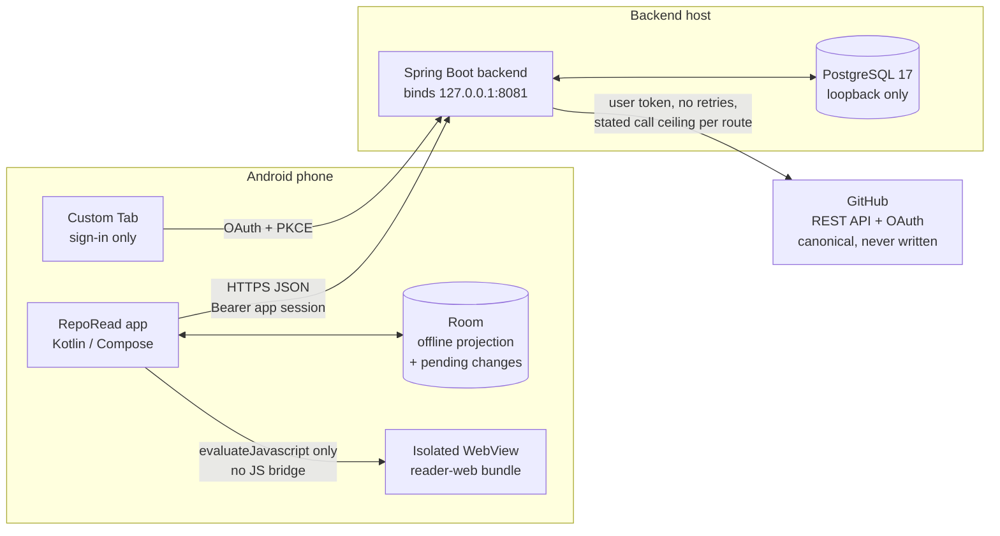

Two rules shape everything below:

- **GitHub is the source of truth and is never written to** ([ADR-02](adrs.md#adr-02--github-is-canonical-and-read-only-note-bodies-are-not-stored-on-the-server)). A note's content is always addressed by its blob SHA.
- **The server renders, the phone displays** ([ADR-04](adrs.md#adr-04--the-server-renders-an-isolated-webview-displays)). One Java renderer defines the HTML and each block's canonical text, so a selection on the phone means the same thing on the server.

## 2. Deployment and delivery

Release builds talk to a hosted backend; debug builds talk to the developer's Mac. Both run the same jar.

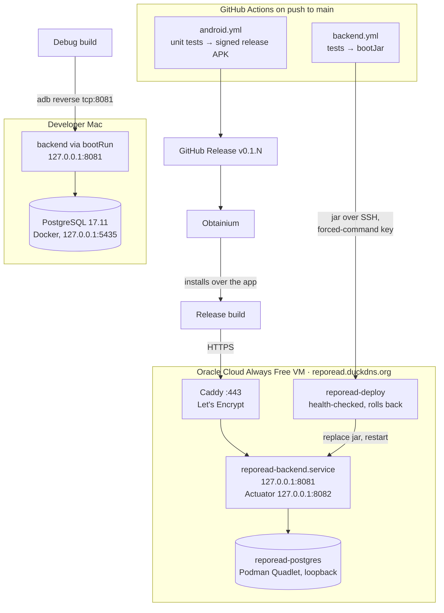

- Only 22, 80 and 443 are open on the VM; PostgreSQL, the API port and Actuator listen on loopback ([ADR-14](adrs.md#adr-14--hosted-backend-on-an-oracle-cloud-always-free-vm-debug-builds-stay-on-the-mac)).
- Every build is signed with one personal key, so release and debug builds install over each other and keep the phone's data ([ADR-12](adrs.md#adr-12--personal-distribution-one-signing-key-backend-over-adb-reverse), [ADR-15](adrs.md#adr-15--app-releases-through-github-releases-installed-by-obtainium)).
- Restarts and deploys keep GitHub sign-ins: tokens are stored encrypted in PostgreSQL under a key file kept on the host, outside the database ([ADR-03](adrs.md#adr-03--github-user-tokens-stay-on-the-server-encrypted-at-rest)).

## 3. Backend

One Spring Boot 4 / Java 25 service, a modular monolith with one package per concern (`backend/src/main/java/com/reporead/`). Data access is plain Spring JDBC; the schema is owned by Flyway migrations (`V1`–`V8`).

### Packages and their dependencies

Arrows point from a package to the packages it calls (from the imports in each file).

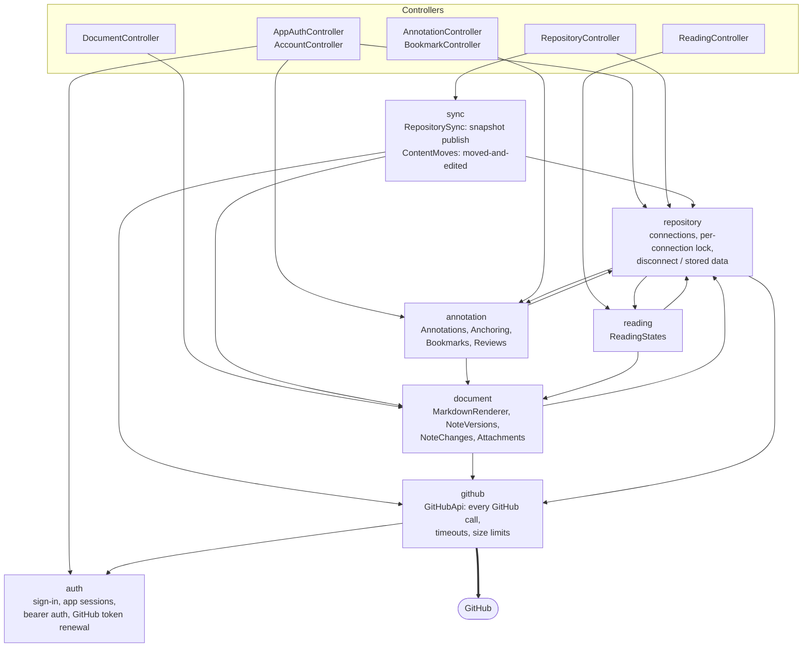

| Package | Owns | Key classes |
| --- | --- | --- |
| `auth` | GitHub OAuth (Spring Security), single-use sign-in codes bound to a PKCE challenge, 30-day bearer sessions (only hashes stored), the encrypted stored GitHub token with its renewal and revocation, account deletion | `GitHubSecurity`, `GitHubTokens`, `AppSignInSuccess`, `AppSessions`, `BearerAuthentication`, `AccountController` |
| `github` | The only HTTP client to GitHub: user token, 15 s timeouts, no redirects, no retries, response size limits | `GitHubApi` |
| `repository` | Which repositories a user has connected; the connection row lock every write shares; disconnect | `RepositoryConnections`, `ConnectionData` |
| `sync` | Publishing a complete tree snapshot of the default branch; document identity across moves ([ADR-07](adrs.md#adr-07--document-identity-from-complete-snapshots)) | `RepositorySync`, `ContentMoves` |
| `document` | Rendering and sanitizing Markdown into reader HTML with canonical block text; fetching a version by blob SHA; changes since last read ([ADR-09](adrs.md#adr-09--changed-since-last-read-compares-the-version-actually-read-by-source-lines)); images and Obsidian embeds | `MarkdownRenderer`, `NoteVersions`, `NoteChanges`, `Attachments` |
| `reading` | Last-read version, position and progress per note; last write wins by the client's time | `ReadingStates` |
| `annotation` | Highlights, cards and bookmarks; idempotent creation by mutation id; re-anchoring ([ADR-06](adrs.md#adr-06--re-anchor-only-on-measured-evidence-otherwise-orphan)); the immutable review log | `Annotations`, `Anchoring`, `Bookmarks`, `Reviews` |
| root | Error responses (`{code, message}`), client clock bounds | `ApiErrors`, `ApiFailure`, `ClientClock` |

### Data model (PostgreSQL)

Bookmarks, highlights and cards share the `annotations` table, told apart by `type`. A highlight or card has an original anchor that never changes and a current location that re-anchoring moves.

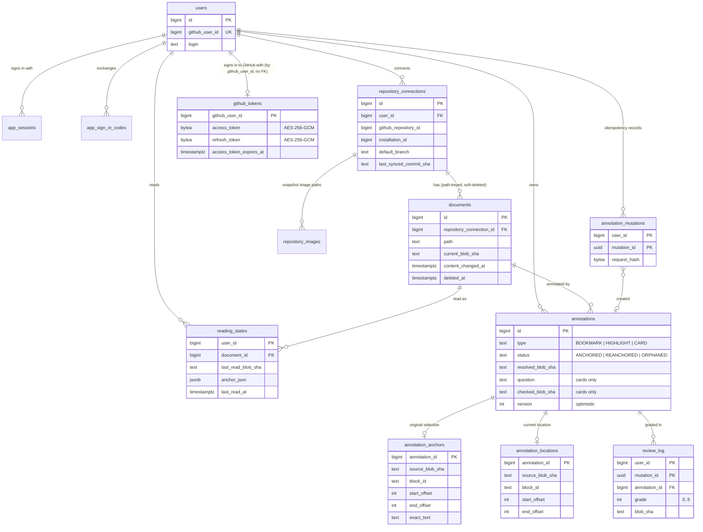

Concurrency: syncs, disconnects and every write that adds rows for a document take the same `repository_connections` row lock (`RepositoryConnections.lockForSync` and its siblings), so a write never lands half-way through a sync or a disconnect.

## 4. Android app

One Activity (`MainActivity`) hosting Compose (`RepoReadApp`), with its own back stack of `Screen` values encoded as strings so it survives process death. No navigation library, no DI framework, no background work.

### Screens and layers

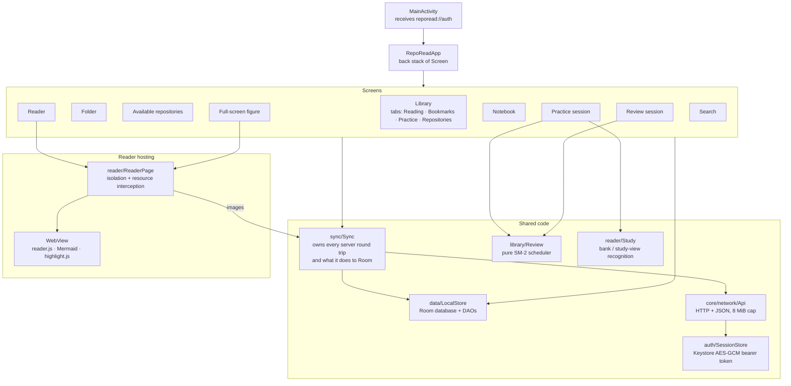

| Package | Owns |
| --- | --- |
| `auth` | PKCE sign-in through a Custom Tab; the encrypted bearer session |
| `core/network` | `Api`: one HTTP client, bounded responses, `ApiException(status, code)` from the server's error body |
| `data` | `LocalStore`: Room entities and DAOs (schema history in `android/schemas/`) |
| `sync` | `Sync`: refreshes, opening notes, the explicit foreground sync, annotation and card mutations, disconnect and account deletion |
| `library` | Library tabs, Notebook (with Markdown export), Practice sessions, Review sessions, and the SM-2 scheduler (`Review.kt`) |
| `reader` | The reader screen, page hosting and isolation, outline, notes sheet, backlinks, link resolution and previews, changes since last read, study view, answer views, full-screen figures |
| `search` | Local substring search over saved titles, note text and highlights ([ADR-10](adrs.md#adr-10--search-is-local-substring-matching-over-what-the-phone-has-saved)) |
| `reader-web/` | The page's display JavaScript and CSS, bundled by esbuild into the APK; parses no Markdown and makes no network requests |

### Room: a projection plus pending changes

Room never decides anything the server owns; it mirrors complete server responses and queues the user's own changes until acknowledged ([ADR-08](adrs.md#adr-08--offline-a-room-projection-plus-explicit-pending-changes)).

| Table | Comes from | Pending local changes? |
| --- | --- | --- |
| `repositories`, `documents` | Server's complete lists (replaced, never merged) | No |
| `notes` | Latest rendered copy of each opened note, keyed by document and blob SHA, with its canonical text for search | No |
| `reading_states`, `bookmarks` | Server lists, merged with local saves | Yes, last write wins by time |
| `annotations` | Notebook and per-note listings | Yes: creations (with mutation id) and deletions of unacknowledged creations |
| `review_log` | Server's durable log | Yes: grades (with mutation id) |
| `review_limits` | Server-owned session limit (40) | No |
| `change_baselines` | Phone only: the oldest read version whose changes haven't been shown yet | n/a |

## 5. Key flows

### Sign-in

The phone never sees a GitHub credential. It gets an opaque app session in exchange for a one-time code bound to its own PKCE challenge.

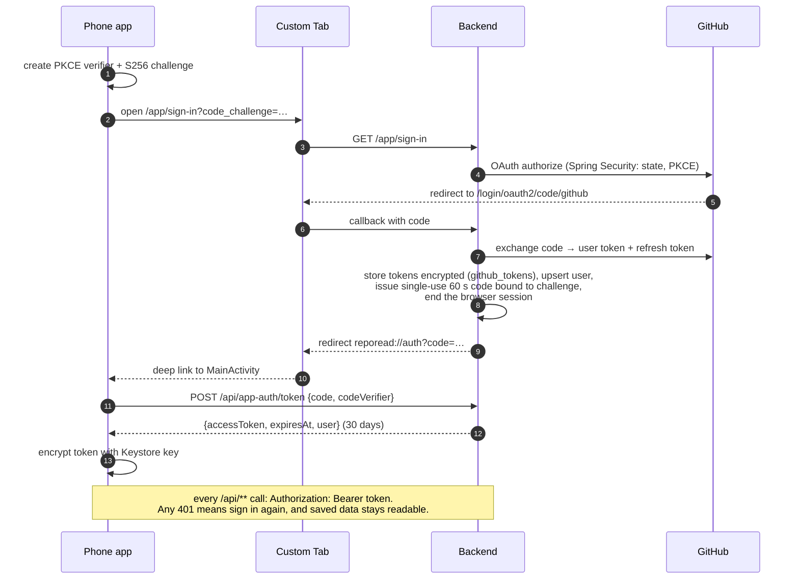

### Refreshing a repository (sync)

A sync publishes one complete snapshot of the default branch or changes nothing ([ADR-07](adrs.md#adr-07--document-identity-from-complete-snapshots)).

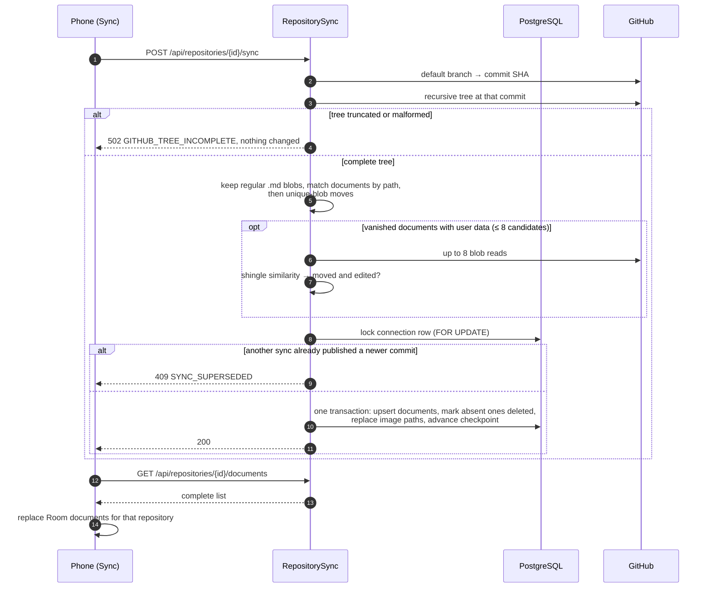

### Opening and displaying a note

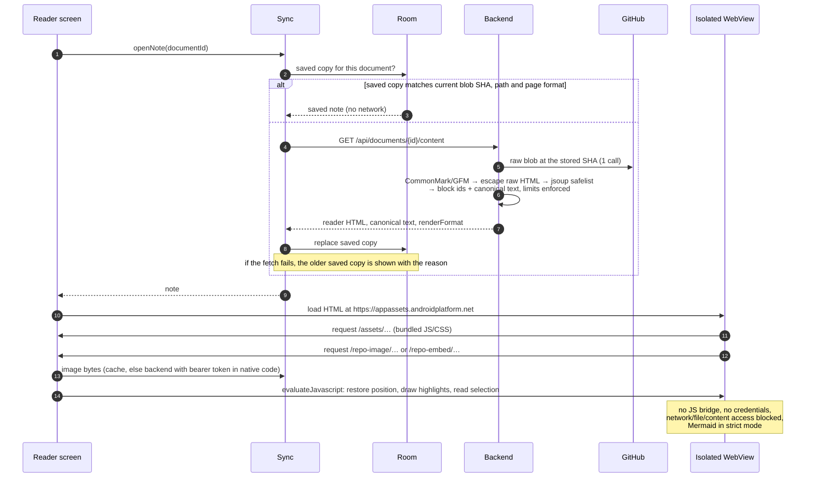

Links the page needs native help with (`/note-link`, `/copy-code`, `/full-screen`) are same-origin URLs the app intercepts; the page itself can't call native code.

### Highlights, cards and the foreground sync

Local changes are written to Room first and sent only at explicit sync points: opening the Library, tapping Sync, opening a note. There is no background sync and no retry framework; the mutation id makes resending safe.

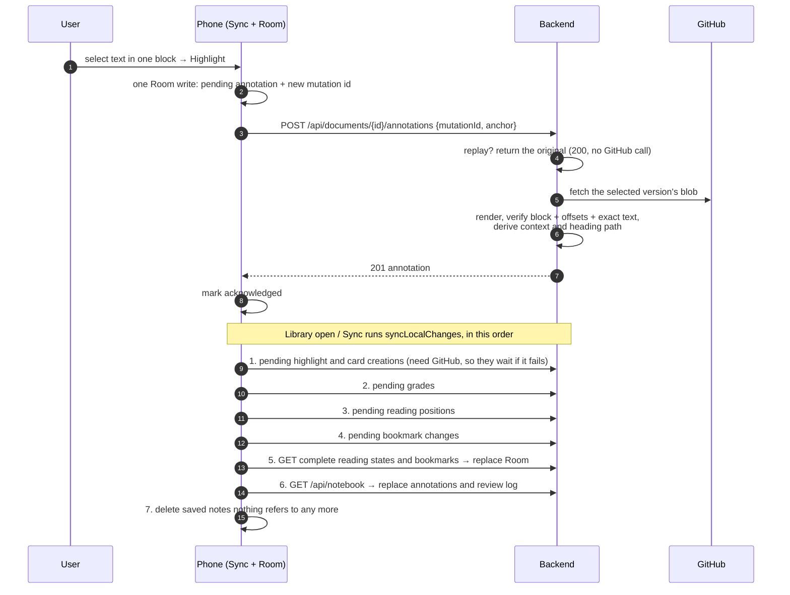

A refused item (400/404/409/410/422) is marked and the run continues; any other failure ends the run with everything unacknowledged still pending.

### Re-anchoring

When a note changes, each highlight or card is resolved against the new version the next time the note's annotations are listed. The original anchor never changes ([ADR-05](adrs.md#adr-05--anchors-are-block-ids-and-utf-16-offsets-into-canonical-text-of-one-version), [ADR-06](adrs.md#adr-06--re-anchor-only-on-measured-evidence-otherwise-orphan)).

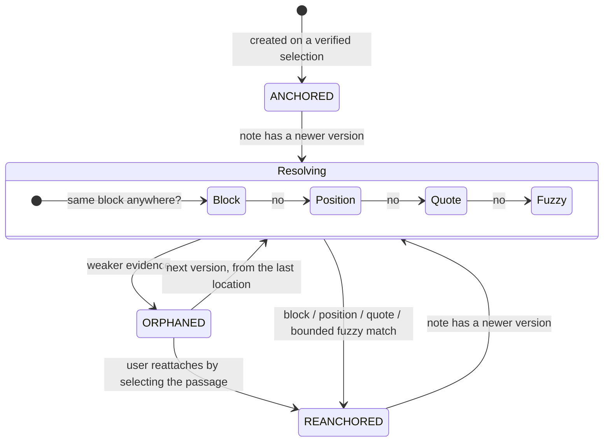

### Practice and review

Cards are anchored annotations with a question. The server owns the immutable review log and the session limit; the phone owns scheduling ([ADR-13](adrs.md#adr-13--anchored-cards-server-review-log-phone-only-sm-2-scheduling)).

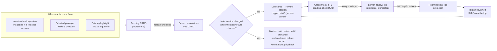

Practice questions are recognized on the phone from saved copies of notes under an `interview/` folder (`reader/Study.kt`); a Practice session makes no network calls.

## 6. Trust boundaries

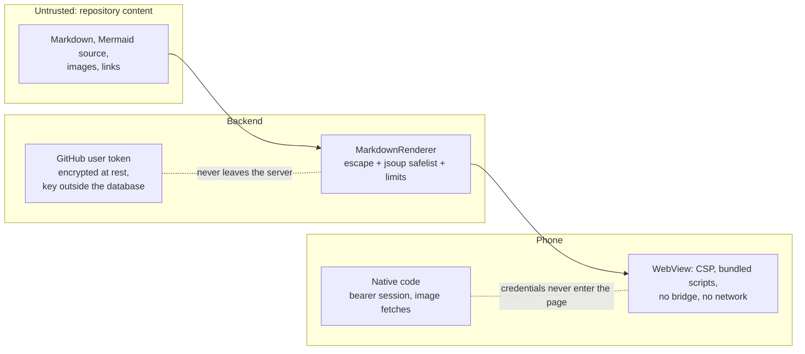

- The GitHub token stays on the server; the phone holds only a revocable app session ([ADR-03](adrs.md#adr-03--github-user-tokens-stay-on-the-server-encrypted-at-rest)).
- Rendered content can't run code: raw HTML is escaped, output is sanitized, and the WebView only loads bundled assets and the note's own images through native code.
- Every route is scoped to the signed-in user; another user's ids return 404 without a GitHub call.
- The release signing key is also a GitHub Actions secret, so the GitHub account is part of the app's trust boundary ([ADR-15](adrs.md#adr-15--app-releases-through-github-releases-installed-by-obtainium)).

## 7. Where the details live

| Topic | Source |
| --- | --- |
| Why each decision was made, and what it costs | [adrs.md](adrs.md) |
| Rules every change keeps | [invariants.md](invariants.md) |
| Scope, stage gates, post-MVP status, known gaps, what is unverified | [feature-list.md](feature-list.md) |
| User needs and acceptance criteria | [user-stories.md](user-stories.md) |
| Every route, its GitHub call ceiling, error codes, server-owned limits, metrics | [backend/README.md](../backend/README.md) |
| Hosted VM layout and deploys | [backend/README.md § Hosted VM](../backend/README.md#hosted-vm) |
| Phone behaviour, offline rules, signing, device tests, Room schema versions | [android/README.md](../android/README.md) |
| Reader display bundle and its device check | [android/reader-web/README.md](../android/reader-web/README.md) |
